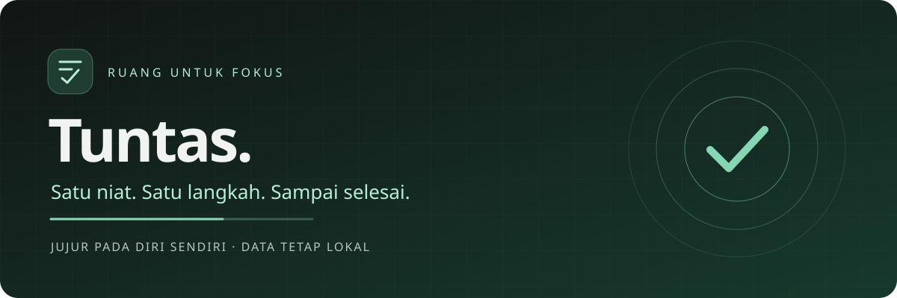

<div align="center">



# Tuntas

**Selesaikan yang penting, baru lanjutkan.**

Aplikasi fokus Android berbasis kejujuran. Jadwalkan niatmu, kurangi distraksi,<br>
dan kembali ke aplikasi lain setelah mengonfirmasi pekerjaanmu selesai.


[Alur fokus](#alur-fokus) · [Mulai dengan aman](#mulai-dengan-aman) · [Build sendiri](#build-sendiri) · [Batasan](#batasan-dan-status)

</div>

---

## Fokus tanpa berpura-pura

Tuntas bukan mesin pembuktian produktivitas. Kamu sendiri yang menyatakan sebuah task sudah selesai. Saat waktunya tiba, Tuntas menampilkan ruang fokus khusus dan **berupaya mengarahkan aplikasi di luar daftar yang diizinkan kembali ke Tuntas** melalui layanan Aksesibilitas yang kamu aktifkan sendiri.

- **Waktu yang jelas** — tanggal pertama dan jam mulai wajib; kunci lebih awal bersifat opsional.
- **Ritme yang fleksibel** — sekali, harian, mingguan pada hari pilihan, atau bulanan.
- **Satu per satu** — task yang bertumpuk tetap tertunda sampai semuanya dikonfirmasi selesai.
- **Lokal sejak awal** — tanpa akun, backend, analitik, atau koneksi jaringan saat memakai aplikasi.
- **Kendali tetap milikmu** — izin dapat dicabut; jalur pemulihan sistem tidak disembunyikan.

> **Versi pengembangan, bukan pengunci sistem.** Tidak memakai root, Device Owner, atau mode kiosk; tidak menjanjikan anti-bypass maupun akses darurat yang terjamin di semua perangkat.

## Alur fokus

| Mode | Yang tersedia |
| :--- | :--- |
| **Normal** | Buat, ubah, dan hapus task; pilih aplikasi yang boleh dibuka; periksa kesiapan izin. |
| **Terkunci** | Lihat task tertunda, konfirmasi selesai, buka telepon dan aplikasi pilihan yang masih dapat diluncurkan. Daftar aplikasi hanya-baca; editor, navigasi normal, serta perubahan task/daftar aplikasi tidak tersedia. |
| **Memeriksa data** | Jika data belum berhasil dimuat, perubahan tidak dibuka. Coba muat ulang; tombol telepon tetap ditampilkan. |

1. Buat task dengan judul, tanggal pertama, dan **jam mulai**.
2. Bila perlu, isi **kunci lebih awal** dalam menit. Mulai **08:00** dengan lead **10 menit** berarti waktu kunci **07:50**; kosong atau nol berarti saat jam mulai.
3. Ketika waktu kunci tercapai, task menjadi tertunda. Jam mengikuti zona waktu perangkat; tanggal lampau atau lead yang sudah lewat dapat langsung membuat task tertunda.
4. Pilih **Tandai selesai…**, lalu **Ya, sudah selesai**. **Belum** atau menutup dialog tidak menyelesaikan task.
5. Mode normal kembali hanya setelah **semua** task tertunda selesai. Menyelesaikan satu kejadian tidak menghapus jadwal berulang.

### Pengulangan yang tidak mengejutkan

| Jadwal | Perilaku |
| :--- | :--- |
| Sekali | Satu kejadian pada tanggal pertama. |
| Harian | Setiap hari mulai tanggal pertama. |
| Mingguan | Pada hari-hari yang dipilih, mulai tanggal pertama. |
| Bulanan | Pada tanggal 1–31 yang dipilih. Bulan tanpa tanggal tersebut **dilewati**, bukan dipindah ke akhir bulan. |

Task tertunda tidak hilang saat tengah malam. Beberapa kejadian terlewat dari task yang sama dirangkum menjadi satu kewajiban tertunda, bukan antrean tanpa batas. Task berbeda tetap harus diselesaikan masing-masing.

## Mulai dengan aman

1. Build dari sumber yang kamu percaya dan periksa APK sebelum memasangnya. Izinkan instalasi dari sumber tersebut hanya jika memang diperlukan.
2. Saat mode normal, buka **Darurat** dan pilih aplikasi penting yang perlu tetap tersedia. Uji tombol buka aplikasi tanpa membagikan data pribadi.
3. Baca penjelasan di **Izin** sebelum memberi persetujuan **Aksesibilitas**. Ini izin sensitif: Tuntas mengamati nama paket dan kelas jendela untuk mengarahkan aplikasi, bukan untuk membuktikan pekerjaanmu selesai.
4. Pada Android 12+, periksa izin **Alarm & pengingat**. Tanpa izin alarm tepat, aplikasi memakai fallback tidak tepat dan menampilkan kesiapan menurun; pemicu bisa terlambat.
5. Segarkan status. Izin Aksesibilitas aktif **dan** layanan tersambung diperlukan untuk kesiapan pembatasan. Mulailah dengan task percobaan yang tidak kritis.

Pada Android 13+, APK sideload mungkin memerlukan persetujuan **Izinkan setelan terbatas** di info aplikasi, jika opsi itu tersedia dan kamu mempercayai sumbernya. Play Protect dapat memblokir APK sideload dari internet, khususnya yang meminta Aksesibilitas. Jangan menonaktifkan perlindungan secara global atau mencoba melewati blokir; hentikan instalasi dan tinjau sumber serta peringatan Android.

### Privasi dan izin

- Manifest aplikasi tidak meminta izin `INTERNET`. Task, status selesai, pilihan aplikasi, dan diagnostik pembatasan disimpan lokal di ruang aplikasi.
- Layanan hanya menerima `TYPE_WINDOW_STATE_CHANGED` dan membaca nama paket/kelas. `canRetrieveWindowContent="false"` dan `canPerformGestures="false"`: pengambilan isi jendela serta gestur dinonaktifkan. Tidak membaca teks layar, input sandi, atau isi notifikasi.
- Diagnostik lokal dapat menyimpan paket/kelas terakhir yang diarahkan, waktu, dan jumlah intersepsi. Jangan bagikan log atau screenshot pribadi tanpa menyamarkannya.
- Konfigurasi aplikasi menonaktifkan backup dan mengecualikan data dari cloud backup/transfer perangkat; jangan mengandalkannya sebagai mekanisme pemulihan data.
- Izin penerimaan boot dipakai untuk rekonsiliasi jadwal **setelah perangkat dibuka kuncinya**. Tidak ada penjadwalan sebelum unlock pertama setelah reboot.

Detail dapat diperiksa pada [manifest](app/src/main/AndroidManifest.xml) dan [konfigurasi Aksesibilitas](app/src/main/res/xml/accessibility_service_config.xml).

## Build sendiri

### Prasyarat

| Komponen | Versi konfigurasi |
| :--- | :--- |
| JDK | **17** |
| Android SDK | Platform **34**, Build Tools **34.0.0** |
| Gradle Wrapper | **8.7** — sudah disertakan, termasuk JAR wrapper |
| Android Gradle Plugin | **8.4.1** |
| Kotlin | **1.9.24**, target JVM 17 |
| Compose | Compiler **1.5.14**, BOM **2024.06.00** |
| Perangkat | Android **8.0 / API 26+**; target SDK 34 |

Pasang Android SDK dan arahkan `ANDROID_HOME` ke lokasi SDK lokal, atau buat `local.properties` berisi `sdk.dir` pada komputermu (jangan commit). Build pertama memerlukan internet untuk Gradle dan dependensi; penggunaan aplikasi setelah terpasang tetap offline.

```bash
git clone git@github.com:Nyuuk/tuntas.git
cd tuntas
./gradlew assembleDebug testDebugUnitTest lintDebug
```

Clone di atas memerlukan akses SSH GitHub yang sudah dikonfigurasi. Di Windows, gunakan `gradlew.bat` untuk perintah build.

- **APK debug:** `app/build/outputs/apk/debug/app-debug.apk`
- **Laporan unit test:** `app/build/reports/tests/testDebugUnitTest/index.html`
- **Laporan lint:** `app/build/reports/lint-results-debug.html`

Konfigurasi membatasi Gradle ke satu worker, tanpa daemon, heap 1 GiB, dan kompilasi Kotlin in-process. Jika seluruh dependensi telah tersedia di cache, tambahkan `--offline --max-workers=1 --no-daemon`. APK debug ditandatangani dengan debug key lokal oleh tooling Android; **bukan rilis produksi**, dan key tidak disertakan di repositori.

## Rilis dan pembaruan

Aturan lengkap dan antarmuka validator ada di [panduan rilis](docs/RELEASING.md); perubahan dicatat di [CHANGELOG](CHANGELOG.md). `version.properties` adalah sumber versi tunggal; versi development saat ini sengaja ditolak untuk publikasi. Validator membutuhkan Python 3.9+ tanpa dependensi tambahan:

```bash
python3 -m unittest discover -s scripts/tests -v
```

Rilis memerlukan kenaikan versi, catatan perubahan bermakna, commit bersih yang ditinjau dan terjangkau dari `main`, serta tag **annotated** yang cocok. **Minta persetujuan eksplisit Adnan atas commit/tag sebelum push tag atau publikasi**, termasuk rilis pertama. Menyiapkan otomasi tidak mengizinkan publikasi; tidak setiap tag sembarang boleh menjadi rilis. `v0.1.0-rc.1` hanya contoh konseptual, bukan tag yang telah dibuat.

APK rilis harus memakai kunci rilis khusus yang disimpan di luar sumber. Gradle membaca `TUNTAS_KEYSTORE_FILE`, `TUNTAS_KEYSTORE_PASSWORD`, `TUNTAS_KEY_ALIAS`, dan `TUNTAS_KEY_PASSWORD` dari environment; task release gagal bila input tidak lengkap, tanpa fallback APK unsigned/debug. Build debug tidak memerlukan rahasia rilis. Jangan bagikan nilai environment atau log signing. Publikasi harus menyertakan APK bertanda tangan yang diverifikasi, SHA256 **sesudah signing**, dan catatan rilis dari commit tepat yang sama; panduan rilis menjabarkan pemeriksaan wajib workflow. Dokumen ini tidak mengklaim workflow publikasi sudah tersedia.

**Sertifikat rilis baru tidak kompatibel untuk update di atas instalasi debug.** Jangan uninstall atau hapus data sekadar memaksa pemasangan bila datanya penting: tindakan itu menghilangkan data lokal. Belum ada ekspor/pemulihan atau jaminan migrasi lintas versi. Untuk pembaruan rilis dengan sertifikat yang sama, pasang di atas instalasi yang ada dan uji pelestarian data di perangkat; jangan menganggap unit test membuktikannya.

## Batasan dan status

**Masih dalam pengembangan.** Unit test JVM mencakup pengulangan, persistensi, konfirmasi, penjadwalan, kebijakan pembatasan, serta guard mode terkunci. Itu bukan bukti perilaku fisik atau hasil render UI. **Penerimaan manual UI terkunci terbaru masih pending**, termasuk Back, rotasi, keyboard, dan transisi saat editor terbuka.

- Doze, hemat baterai, pembatasan OEM, pencabutan izin, atau layanan terputus dapat mengurangi keandalan. Bahkan alarm tepat bukan jaminan waktu eksekusi.
- Force-stop menghentikan alarm sampai aplikasi dibuka kembali. Setelah reboot, buka kunci perangkat dan periksa ulang kesiapan.
- Telepon/darurat, keyboard, dan permukaan sistem penting diupayakan tetap diizinkan. Tombol telepon memakai `ACTION_DIAL`, **tidak langsung menelepon**. Ini **bukan jaminan akses dari lockscreen** atau kompatibilitas darurat semua perangkat; jangan lakukan panggilan darurat nyata untuk pengujian.
- Jangan gunakan Tuntas untuk kebutuhan keselamatan, kontrol orang lain, atau kewajiban yang memerlukan penegakan mutlak.

Lihat [panduan pengujian manual](docs/TESTING.md) untuk pemeriksaan sebelum mengandalkannya.

### Update tanpa kehilangan data

Pasang update **di atas aplikasi yang ada**, tanpa uninstall atau hapus data. Android memerlukan application ID yang sama (`com.tuntas.app`), **sertifikat penandatangan yang sama**, dan version code yang kompatibel (tidak lebih rendah). Build debug dari komputer lain dapat memakai key berbeda dan ditolak sebagai update; jangan uninstall untuk memaksa kecocokan jika datanya penting.

Jangan menimpa build produksi dengan build debug. Simpan kunci penandatangan secara aman di luar repositori. Belum ada migrasi lintas versi skema maupun fitur ekspor/pemulihan data; bila muncul kesalahan penyimpanan, jangan hapus data dan jangan menganggap update otomatis memperbaikinya. Pemasangan update serta pelestarian data tetap perlu diuji di perangkat.

### Keluar dan pemulihan

Nonaktifkan layanan melalui **Setelan Android → Aksesibilitas → Tuntas** bila perlu. Ini tidak menghapus task. Uninstall atau hapus data akan menghilangkan data lokal; lakukan hanya jika kamu memahami konsekuensinya. Jalur pemulihan Android memang tetap terbuka, bukan celah yang dijanjikan akan ditutup.

## Peta sumber

```text
app/src/main/
├── java/com/tuntas/app/
│   ├── domain/               # pengulangan, transaksi dan persistensi task
│   ├── platform/blocker/     # layanan Aksesibilitas dan kebijakan paket
│   ├── platform/scheduling/  # alarm dan rekonsiliasi
│   └── ui/                   # Compose, draft dan mode presentasi
└── res/                      # ikon lokal, tema dan konfigurasi Android
app/src/test/                 # unit test JVM
docs/                         # panduan publik dan identitas visual lokal
```

Layar diagnostik lama pada `ui/diagnostic/` tetap ada di sumber tetapi bukan entry point UI utama. Untuk kontribusi, jelaskan perilaku yang diubah, tambahkan regresi yang relevan, dan jalankan build, unit test, serta lint. Jangan sertakan key, konfigurasi SDK lokal, data pengguna, APK, atau log perangkat. Perubahan izin dan perilaku darurat harus ditinjau secara khusus.

## Lisensi

Kode proyek tersedia sebagai **source-available**, dengan lisensi **PolyForm-Noncommercial-1.0.0** ([teks lengkap](LICENSE), [sumber resmi](https://polyformproject.org/licenses/noncommercial/1.0.0)). Ini **bukan lisensi open source OSI**. Lisensi mengizinkan tujuan nonkomersial dan secara eksplisit mengizinkan penggunaan oleh organisasi amal, institusi pendidikan, organisasi riset publik, keselamatan/kesehatan publik, perlindungan lingkungan, serta institusi pemerintah tanpa memandang sumber pendanaan atau kewajiban akibat pendanaan. Ringkasan ini bukan larangan menyeluruh atas semua penggunaan organisasi, penggunaan berpendanaan atau nonprofit; rujuk teks lisensi untuk ketentuan lengkap.

Komponen pihak ketiga, termasuk Gradle Wrapper dan dependensi Android, tetap mengikuti lisensi masing-masing; lisensi proyek tidak melisensikan ulang komponen tersebut. Pertahankan teks/URL lisensi dan notice yang berlaku saat mendistribusikan sumber atau APK.
